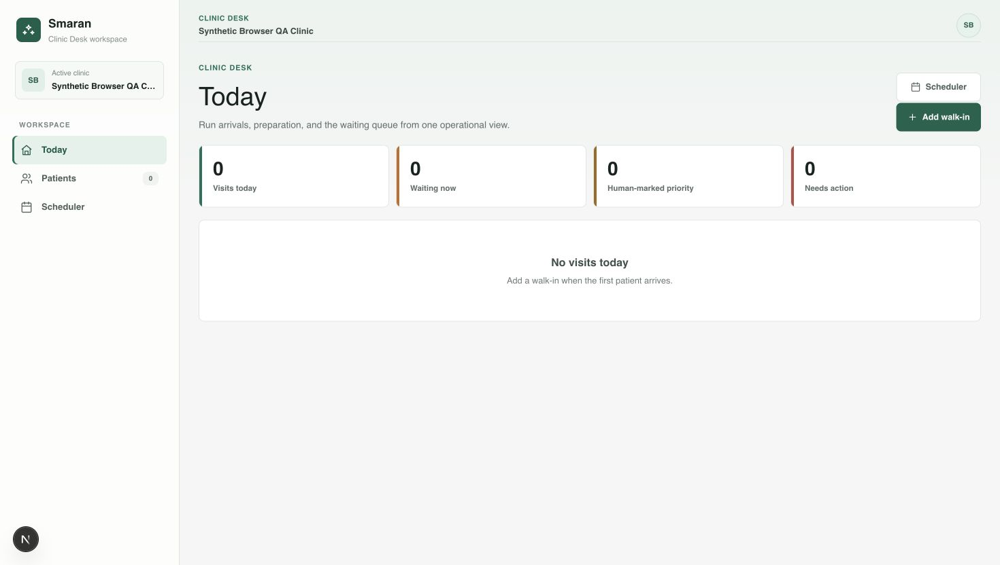

# Authenticated browser QA attempt — 14 October 2026

Real synthetic receptionist sign-in and the authenticated Clinic Desk landing
passed. The remaining browser journeys are blocked by the desktop computer-use
tool connection closing during navigation. This attempt does not establish full
authenticated clinic E2E coverage.

Source branch: `dev-neelesh`, HEAD
`80d10b1f74c1102616720f77c118c42b6c8635fe`. All 273 files in the prepared app's
`src` snapshot matched the clinical checkout byte-for-byte. No production source,
migration, CI definition, signup policy, or existing regression was changed.

## Local setup actually completed

- Started only `smaran-engineering-oct13`, with API/DB ports 56521/56522 and
  repository migrations through 0107. Existing user database projects were not
  reset or stopped.
- Used the local Auth admin API to provision three fictional sign-in users:
  assistant/reception, assigned doctor, and foreign-clinic doctor. Their profiles
  and memberships were placed in synthetic clinics. Signup remained disabled.
- Accounted for the real Auth trigger's automatic profile/membership creation.
  The initial duplicate-profile setup error was corrected in the fixture recipe;
  it was not an application defect. All temporary users from the attempt were
  later destroyed with the disposable project.
- Ran an ignored snapshot of the actual clinical app on
  `http://smaran-auth-qa.localhost:56731`, keeping its browser cookie/storage origin
  separate from ordinary localhost applications. Auth, middleware, cookies,
  application routes, PostgreSQL/RLS and Storage clients were not mocked.
- The test-only Webpack configuration substitutes a document-only worker with a
  mock extraction adapter. It excludes the shared speech/draft worker. The app
  process receives no provider keys and a loopback-only server network guard.
  No provider or speech processing was invoked in the browser steps reached.

Credential-free setup recipes are retained in
`evidence/auth-browser-2026-10-14/setup-source/`. These mirror the ignored test-app
layout; they are not production configuration. Runtime keys and random passwords
were held in ignored private files. A startup excerpt accidentally included
generated local keys; this was disclosed. No production credential was involved,
and this attempt's private files were removed after project destruction.

## Passed browser behavior

Supported Chrome controls opened the actual `/login` page and filled the existing
synthetic receptionist account's email/password. Sign-in completed through local
Supabase Auth. The browser reached `/desk` and displayed **Synthetic Browser QA
Clinic**, Clinic Desk navigation, and the empty operational summary.

A separate read-only PostgreSQL check confirmed an Auth sign-in timestamp, role
`assistant`, and the intended clinic assignment. The synthetic clinic still had
zero patients and zero consultations; no patient/visit creation is claimed.

Evidence: `01-reception-authenticated.txt`, `auth-verification.json`, and
`source-snapshot.log` under `evidence/auth-browser-2026-10-14/`.

## Exact infrastructure blocker

1. Activating **Add walk-in** through the supported Playwright locator timed out
   waiting for `Input.dispatchMouseEvent`; a fresh state still showed `/desk`.
2. A documented AX click focused the link but did not complete navigation.
3. Activating the focused link with the documented Return key then failed with
   **Transport closed** after a 73-second tool call.
4. A bounded `cua.getState()` connection check immediately returned the same
   **Transport closed** error.

The supported browser tool therefore became unavailable. No alternate browser
automation, raw protocol command, or terminal HTTP simulation was used. This is
an observed tool-transport blocker, not a demonstrated application/Auth failure.
The earlier unattempted Auth setup gap has been partly addressed: actual local
sign-in now passed, while the clinic journeys remain unverified in the browser.

Required input is restoration/reconnection of the desktop computer-use/browser
tool, followed by resuming supported controls. No production login or additional
external account is needed. `browser-transport-blocker.log` records the sequence.

## Checks, cleanup and remaining coverage

The prepared snapshot passed `tsc --noEmit`; all three CJS setup recipes passed
`node --check`. Product source was unchanged, so the already completed 215 unit,
1,239 SQL, 16 integrity and four route-handler journey checks were not redundantly
rerun. Their evidence and tested code SHA remain in the earlier QA report.

The task-only Supabase project was stopped with `--no-backup`, destroying its
synthetic Auth users and database. No listener remained on port 56731 after the
transport interruption. Private credential/debug files were removed; the existing
user projects remained running. Retained evidence passed credential-pattern
scanning. The prepared ignored source snapshot remains available for retry, but
fresh task-local Auth fixtures will be required after restarting the project.

Remaining browser coverage includes patient registration/walk-in, doctor sign-in,
intake/documents, manual note save/reload/approval, returning visits, repeated or
interrupted mutations, and role/clinic denial. The document worker override and
Storage HTTP flow were prepared but not reached. Hosted CI remains deferred;
there was no push, deployment, live migration, provider call or Sarvam work.
