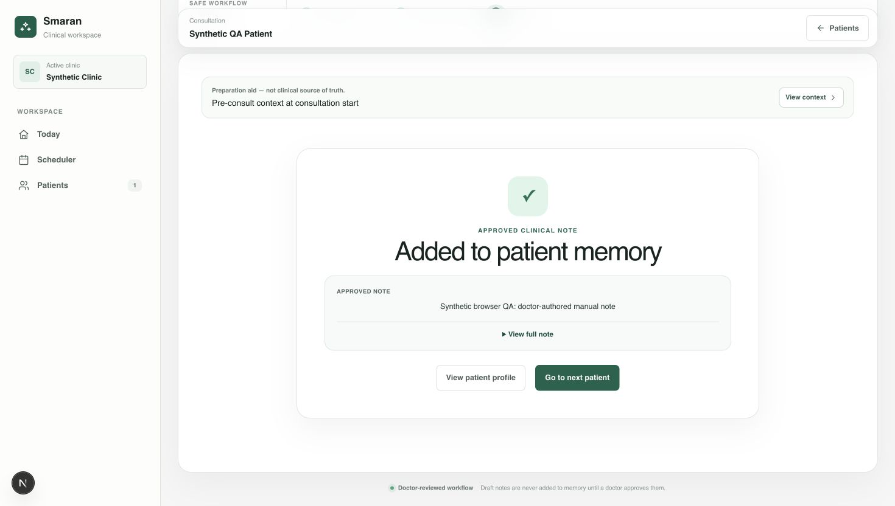

# Synthetic consultation browser check — 2026-10-14 UTC

Observed in Chrome using the supported CUA browser controls at http://127.0.0.1:56730/.
The disposable preview imported the real ConsultationWorkflow component; all note HTTP responses were mocked. No account, patient, provider, audio recording, or speech connection was used.

1. The consent screen rendered the fictional Synthetic QA Patient and Synthetic Clinic.
2. Clicked Patient declined recording. The real component opened the manual prescription workflow and stated that no audio or transcript was created.
3. Entered Synthetic browser QA: doctor-authored manual note in Consultation summary; clicked Save draft.
4. Observed Draft saved and the edited request with expectedRevision=null.
5. Checked the doctor-written approval acknowledgement; clicked Approve note.
6. Observed Approved / Step 3 of 3 / Added to patient memory, with the same synthetic note. The approved request used expectedRevision=1 from the mocked save response.
7. Captured the approved screen using the browser screenshot API. No browser console error was returned.



A focused detail is saved as `browser-approved.jpg`. Both images contain fictional QA data and show mocked HTTP results.

Request evidence:
```json
[{"status":"edited","content":{"summary":"Synthetic browser QA: doctor-authored manual note","chiefComplaint":"","medicationChanges":"","investigations":"","followUpPlan":"","patientInstructions":"","uncertainItems":""},"expectedRevision":null,"summary":"Synthetic browser QA: doctor-authored manual note"},{"status":"approved","content":{"summary":"Synthetic browser QA: doctor-authored manual note","chiefComplaint":"","medicationChanges":"","investigations":"","followUpPlan":"","patientInstructions":"","uncertainItems":""},"expectedRevision":1,"summary":"Synthetic browser QA: doctor-authored manual note"}]
```

This is component browser QA with mocked HTTP, not a complete authenticated browser E2E test. The separate test:db:clinic-journeys command calls actual Next route handlers and production DB helpers against real PostgreSQL/RLS, with injected auth/transport/storage and mock document providers. Full authenticated browser navigation, cookies, actual Storage HTTP, invitation delivery, background after() scheduling, and hosted provider behavior remain unverified. The preview is disposable test-only scaffolding; it adds no production auth bypass or application route.
